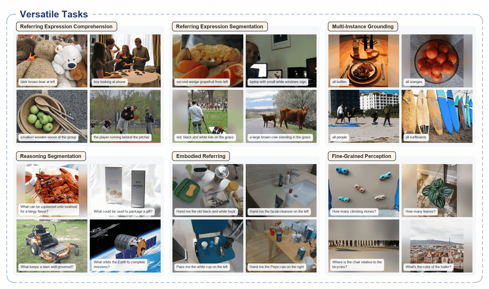
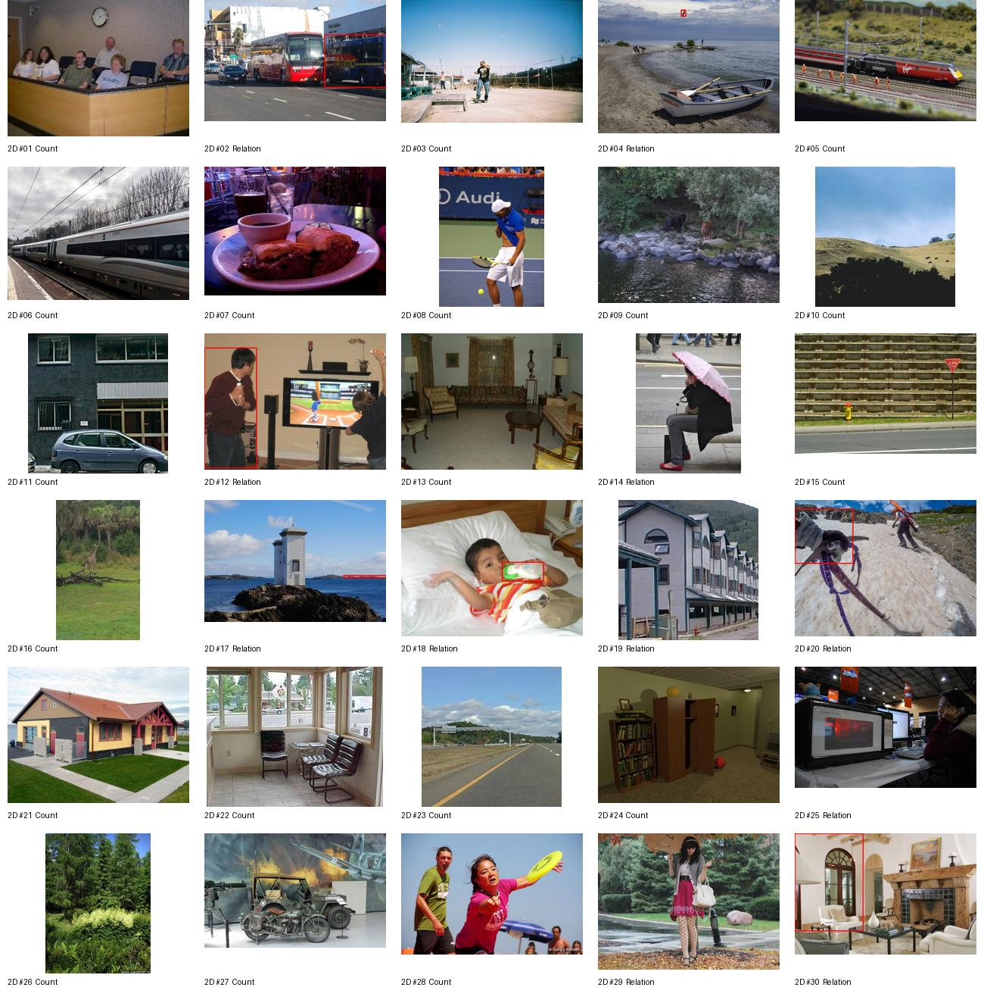
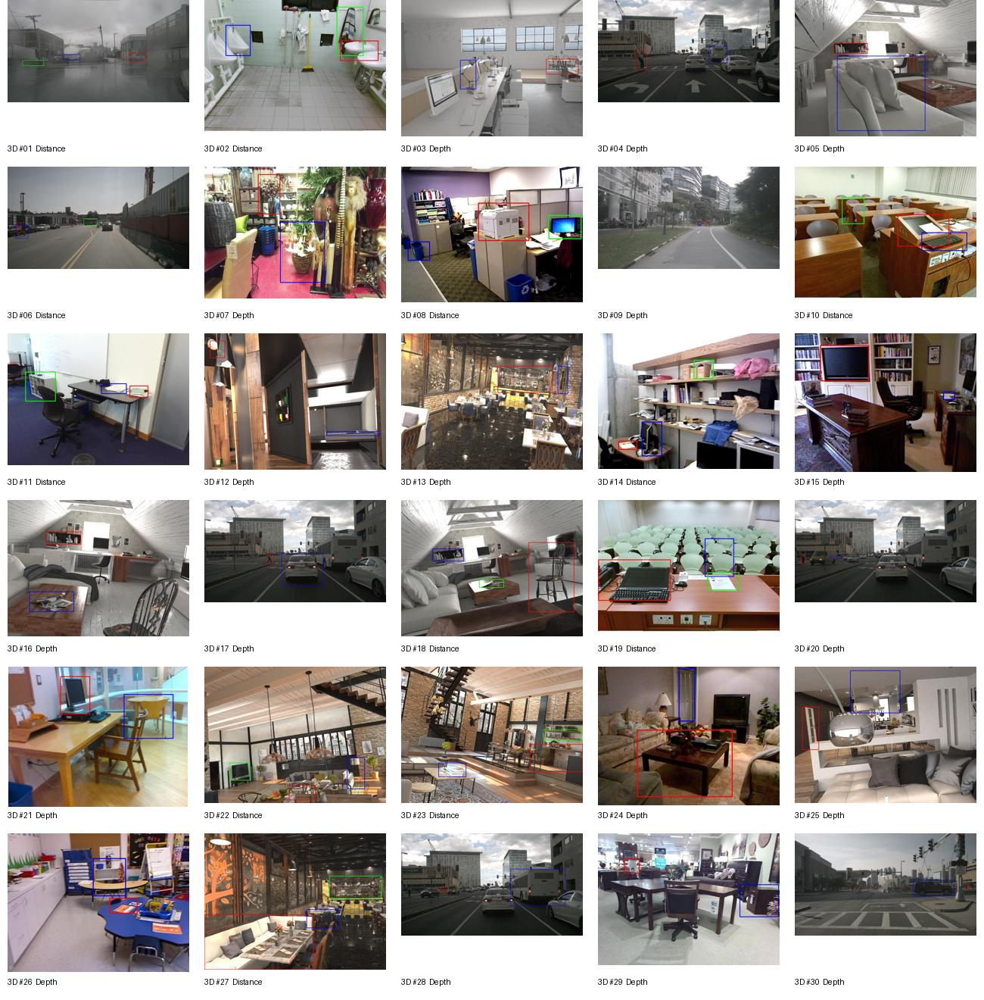

# CV-Bench 双模型综合评测报告：Xiaomi-Lens-0 与 Qwen3.5-4B

> **报告版本：** 2026-11-01  
> **评测范围：** 静态图片输入；Xiaomi-Lens-0、Qwen3.5-4B；历史 Thinking Off / On（max_new_tokens=8192）及新增 Direct Answer（Thinking Off，max_new_tokens=64）。  
> **数据来源：** 本仓库已完成的逐样本预测、metrics、experiment 配置及官方模型资料。没有在本报告生成过程中重新运行模型推理。

本文件作为项目中 CV-Bench 实验的统一入口。原始预测、指标和脚本仍保留在各自目录；本报告汇总结果，不替代原始记录。

## 1. 核心结论

1. **六组全量实验均已完成**：两个模型各运行了历史 Thinking Off、Thinking On 和 Direct Answer Thinking Off；每组均为 2,638 / 2,638 条。没有因本次整理重新推理。
2. **Direct Answer 结果：** Xiaomi-Lens-0 官方 CV-Bench 得分为 **87.04%**，Qwen3.5-4B 为 **85.88%**，Xiaomi 高 **1.16 个百分点（pp）**。逐题配对 McNemar 检验 p=0.0159。
3. **历史 8192 配置中，开启 Thinking 没有提高官方总分：** Xiaomi 从 87.76% 降至 87.29%；Qwen 从 86.76% 降至 85.34%。Qwen Thinking On 有 172 条（6.52%）达到 8,192 Token 上限仍未给出可解析最终答案。
4. **Direct Answer 显著缩短输出和耗时：** 平均生成长度约为 Xiaomi 8 Token、Qwen 9.98 Token；平均端到端耗时分别约 0.299 秒和 0.334 秒。相较历史 Thinking Off，速度改善同时伴随 Prompt、最大生成长度和解析协议变化，不能将改善全部归因于关闭 Thinking。
5. **任务层面：** Direct Answer 下 Xiaomi 在 Count、Relation、Depth 三项略优；Qwen 在 Distance 略优。两者最明显的差异集中在 2D Object Counting。
6. **性能数据不是独占 GPU 基准：** 运行时存在其他 GPU 进程，且两模型的 Transformers 版本和 Attention 后端不同。准确率可按统一数据集和评分规则比较；绝对推理速度只能作为当前机器、当前并发条件下的参考值。

## 2. 模型官方资料与能力范围

### 2.1 Xiaomi-Lens-0

| 项目 | 官方资料 |
|---|---|
| Hugging Face 模型 | [SeerRay-Lab/Xiaomi-Lens-0](https://huggingface.co/SeerRay-Lab/Xiaomi-Lens-0) |
| 官方代码仓库 | [SeerRay-Lab/Xiaomi-Lens-0](https://github.com/SeerRay-Lab/Xiaomi-Lens-0) |
| 技术报告 | [Xiaomi-Lens-0 Technical Report（arXiv:2610.23279）](https://arxiv.org/abs/2610.23279) |
| 项目主页 | [Xiaomi-Lens-0 Project Page](https://seerray-lab.github.io/Xiaomi-Lens-0/) |
| 官方演示 | [官方概览视频（MP4）](../Xiaomi-Lens-0/docs/assets/video/xiaomi_lens_0_overview.mp4)；[官方演示 GIF](../Xiaomi-Lens-0/docs/assets/samples/showcase_all_domains.gif) |

Xiaomi-Lens-0 是一个基于 Qwen3.5 构建的 4B 多模态模型，重点改善细粒度视觉区域理解。它在共享视觉特征上增加轻量 Mask Decoder，并利用特殊的 mask token 状态作为区域查询，使模型可以输出文本、边界框和像素级 Mask。官方报告覆盖六类能力：Referring Expression Comprehension、Referring Expression Segmentation、多实例 Grounding、Reasoning Segmentation、Embodied Referring 和 Fine-Grained Perception。官方报告称其在 RefCOCO / RefCOCO+ / RefCOCOg 八个 split 的指代表达理解上平均比 Qwen3.5 提升 5.6 分；该结果属于官方论文实验，不是本项目的 CV-Bench 成绩。

### 2.2 Qwen3.5-4B

| 项目 | 官方资料 |
|---|---|
| Hugging Face 模型 | [Qwen/Qwen3.5-4B](https://huggingface.co/Qwen/Qwen3.5-4B) |
| 官方技术介绍 / 引用 | [Qwen3.5: Towards Native Multimodal Agents（Qwen Team）](https://qwen.ai/blog?id=qwen3.5) |
| Transformers 使用说明 | [Qwen3.5-4B Model Card / Quickstart](https://huggingface.co/Qwen/Qwen3.5-4B) |
| 官方示例图片 | [模型卡中的图像示例](https://qianwen-res.oss-accelerate.aliyuncs.com/Qwen3.5/demo/CI_Demo/mathv-1327.jpg) |

Qwen3.5-4B 是约 4B 参数的原生视觉语言模型，模型卡给出的结构为 32 层混合架构：每组包含 3 层 Gated DeltaNet 线性注意力和 1 层 Gated Attention；原生上下文长度为 262,144 Token。模型卡公布的评测覆盖语言、视觉语言、空间智能、视频理解、视觉 Agent 等方向。空间智能公开指标包括 ERQA、CountBench、RefCOCO、EmbSpatialBench、RefSpatialBench、LingoQA 等。以上均为 Qwen 官方模型卡结果，并非本项目重新运行的成绩。

**论文说明：** Qwen3.5-4B 模型卡提供的官方引用指向 Qwen Team 的技术博客；本报告未将其误写为独立的 4B arXiv 论文。

## 3. 本地部署与测试环境

### 3.1 测试机器

| 项目 | 实验记录 |
|---|---|
| 操作系统 | Ubuntu 24.04.5 LTS；内核记录为 Linux 7.0.0-38-generic |
| GPU | NVIDIA RTX PRO 6000 Blackwell Workstation Edition |
| 显存 | 96 GB 级别；运行时 PyTorch 记录总显存约 94.96 GiB（环境记录约 97,887 MiB） |
| GPU Compute Capability | 12.0（sm_120） |
| NVIDIA Driver | 580.178.04；驱动侧显示支持 CUDA 13.0 |
| PyTorch CUDA Runtime | 12.8 |
| Python | 3.11.18 |
| PyTorch | 2.10.0+cu128 |
| CPU / 系统内存 | 原实验指标文件未记录具体型号与容量，故不补写推测值 |

注意：nvidia-smi 显示的 CUDA 13.0 是驱动支持级别；实验使用的是 PyTorch Wheel 自带的 CUDA 12.8 Runtime。不要把两者混为一谈。

### 3.2 两个模型各自的环境

| 配置 | Xiaomi-Lens-0 | Qwen3.5-4B |
|---|---|---|
| Micromamba 环境 | xiaomi-lens | vlm-test |
| Python | 3.11.18 | 3.11.18 |
| PyTorch | 2.10.0+cu128 | 2.10.0+cu128 |
| Transformers | 5.4.0 | 5.20.2 |
| 精度 | BF16 | BF16 |
| Attention | flash_attention_2 | SDPA |
| 模型权重 | Hugging Face 本地缓存 | Hugging Face 本地缓存 |

两个环境不能混用：Xiaomi 相关脚本使用 xiaomi-lens；Qwen 相关脚本使用 vlm-test。模型权重没有放入 Git 仓库。

### 3.3 本地部署与评测入口

**Xiaomi-Lens-0**

- [官方单图推理脚本 infer.py](../Xiaomi-Lens-0/infer.py)
- [本地评测适配器](../Xiaomi-Lens-0/eval_xiaomi_cvbench/xiaomi_lens_adapter.py)
- [Direct Answer 评测入口](../eval_cvbench_direct_answer/run_xiaomi_direct_answer.py)
- 官方推理方式：使用官方 infer.py 加载 SeerRay-Lab/Xiaomi-Lens-0，输入单张图片和文本指令，可输出文本、BBox / Mask。

示例命令（路径按项目根目录执行）：

    micromamba run -n xiaomi-lens python Xiaomi-Lens-0/infer.py \
      --checkpoint SeerRay-Lab/Xiaomi-Lens-0 \
      --image dataset/CV-Bench/samples/2D/2d_03.png \
      --text "Describe or locate the target in this image." \
      --output result.jpg --draw-bbox

**Qwen3.5-4B**

- [官方 Transformers 模型卡与加载示例](https://huggingface.co/Qwen/Qwen3.5-4B)
- [本地模型适配器](../eval_qwen35_cvbench/model_qwen35.py)
- [Direct Answer 评测入口](../eval_cvbench_direct_answer/run_qwen35_direct_answer.py)

官方 Transformers 方式使用 AutoProcessor 与 AutoModelForMultimodalLM，调用 Processor 的 Chat Template 构造图文输入，再调用 model.generate()。本项目没有使用 vLLM / SGLang；Qwen 的本地评测入口复用现有 Transformers 适配器。

示例命令：

    micromamba run -n vlm-test python \
      eval_cvbench_direct_answer/run_qwen35_direct_answer.py \
      --limit 1 --show 1

**全量评测复现入口**（仅在确实需要重新运行时使用；不要无意覆盖现有结果）：

    micromamba run -n xiaomi-lens python -B \
      eval_cvbench_direct_answer/run_xiaomi_direct_answer.py --resume

    micromamba run -n vlm-test python -B \
      eval_cvbench_direct_answer/run_qwen35_direct_answer.py --resume

## 4. 官方任务与本项目实际测试范围

### 4.1 官方模型能力 / 官方公开评测

- **Xiaomi-Lens-0：** 官方测试包括指代表达理解、指代表达分割、多实例定位、推理分割、具身指代和细粒度感知；其中部分任务输出 BBox 或 Mask。
- **Qwen3.5-4B：** 官方模型卡公布语言、视觉语言、空间智能、视频理解、视觉 Agent 等基准结果；空间任务包含计数、空间关系和具身空间类 benchmark。

上述为官方发布的能力与结果介绍，**本项目没有重新执行这些官方完整 benchmark**。

### 4.2 本项目自行测试：CV-Bench 静态图片

本项目实际完成的是**单张静态图片输入**：模型接收一张图片和对应的自然语言问题 / 选项，输出多项选择答案，再与 Ground Truth 比较。

- 已测试：静态 RGB 图片。
- 未测试：连续视频帧、视频理解、跨帧时序推理。本报告不对视频能力作结论。
- Xiaomi 官方单图推理脚本还支持 BBox / Mask 输出；但 CV-Bench 评测只计算选择题文本答案，不额外解码或评分 Mask。

## 5. 数据集：CV-Bench

- [Hugging Face 数据集](https://huggingface.co/datasets/nyu-visionx/CV-Bench)
- [Cambrian-1 论文（CV-Bench 来源论文，arXiv:2406.16860）](https://arxiv.org/abs/2406.16860)
- [Cambrian 官方主页](https://cambrian-mllm.github.io/)
- 本地测试文件：dataset/CV-Bench/test_2d.parquet、test_3d.parquet。

CV-Bench 是 Cambrian-1 提出的视觉中心 Benchmark，共 2,638 条人工检查的图文选择题，复用 ADE20K、COCO 和 Omni3D 图像及标注，考察模型的 2D / 3D 基础空间理解。

### 5.1 任务与样本分布

| 维度 | 任务 | 数据来源 | 样本数 |
|---|---|---|---:|
| 2D | Object Counting（Count） | ADE20K | 342 |
| 2D | Object Counting（Count） | COCO | 446 |
| 2D | Spatial Relationship（Relation） | ADE20K | 291 |
| 2D | Spatial Relationship（Relation） | COCO | 359 |
| 3D | Depth Order（Depth） | Omni3D | 600 |
| 3D | Relative Distance（Distance） | Omni3D | 600 |
| **合计** | | | **2,638** |

- 2D：1,438 条；3D：1,200 条。
- Count：788 条；Relation：650 条；Depth：600 条；Distance：600 条。
- 来源：ADE20K 633 条、COCO 805 条、Omni3D 1,200 条。
- 选项数量不固定，数据中有 2、4、5、6 选项题；解析器按每题真实选项集合校验，不固定为 A–D。

### 5.2 样本示例

以下为本地样例目录中的示例图和标注问题，便于理解任务类型。

| 任务 | 样例问题 |
|---|---|
| 2D Count | How many dividers are in the image? |
| 2D Relation | Considering the relative positions of the bus and the truck, where is the bus located with respect to the truck? |
| 3D Depth | Which object is closer to the camera, the table or the lamp? |
| 3D Distance | Which object is closer to the truck, the trailer or the barrier? |

样例标注可查看：[2D annotations.csv](../dataset/CV-Bench/samples/2D/annotations.csv) · [3D annotations.csv](../dataset/CV-Bench/samples/3D/annotations.csv)。

## 6. 评测流程与方法

### 6.1 通用流程

1. 读取本地 test_2d.parquet 和 test_3d.parquet。
2. 解码图片，读取原始 prompt、选项、任务类型、来源和标准答案。
3. 将图片与文本送入各模型对应的 Processor / Chat Template。
4. 使用贪心解码（do_sample=False）生成答案。
5. 按实验协议分离 Thinking 内容或处理 Direct Answer 输出。
6. 严格解析最终选项，与 Ground Truth 比较。
7. 保存逐样本预测、耗时、Token 数、显存和错误原因。
8. 按 2D / 3D、task、source 汇总，并计算官方 CV-Bench 总分。

两个模型均使用 Batch Size = 1、BF16；模型各自只加载一次。图像预处理由各自模型 Processor 执行，因此视觉 Token 数和内部预处理不完全相同。

### 6.2 历史实验：Thinking Off / On，max_new_tokens=8192

历史 experiment 配置实际记录的最大生成长度是 **8,192 Token（不是 8,193）**。该值是生成上限，不代表每题都会生成 8,192 Token。

- Thinking Off：enable_thinking=False。
- Thinking On：enable_thinking=True。
- 统一要求模型在最终回答中输出 FINAL_ANSWER: (X)。
- Thinking On 时，解析器先按 </think> 分离思考区与最终回答区，只在最终回答区解析。
- 达到 8,192 Token 上限仍没有合法最终答案的样本记为截断 / Invalid，并按错误计入分母。

### 6.3 新实验：Direct Answer，Thinking Off，max_new_tokens=64

实验规范名：direct_answer_think_off_max_new_tokens_64_v1。

两个模型均使用官方 Chat Template 的 enable_thinking=False，并追加完全相同的 Direct Answer 指令：

    Answer the multiple-choice question directly.

    Do not provide explanations, reasoning, or analysis.
    Output exactly one line in the following format:

    FINAL_ANSWER: (X)

    where X is one of the provided option letters.

    Do not output anything else.

配置：max_new_tokens=64、do_sample=False、Batch Size=1。64 是最大输出上限，不是固定生成长度。

严格解析规则：

1. 只解码模型新生成的 Token。
2. 去除已确认的结构性结束 Token。
3. 清理首尾空白后，整段必须匹配 FINAL_ANSWER: (X)。
4. X 必须属于当前题目真实选项集合。
5. 有额外文字、多个答案、非法选项或空输出时，标记 Invalid；不从分析文字中猜测答案，不做选项文本模糊匹配。
6. Invalid、截断、推理失败均保留在准确率分母中。

Direct Answer 的 Prompt 版本为 v1；两个模型的 Prompt SHA-1 一致（89db6880…）。

### 6.4 官方评分公式

CV-Bench 官方总分不是全部样本的简单平均：

    Accuracy_2D = (Accuracy_ADE20K + Accuracy_COCO) / 2
    Accuracy_3D = Accuracy_Omni3D
    CV-Bench Accuracy = (Accuracy_2D + Accuracy_3D) / 2

报告同时给出普通样本 Accuracy 与官方加权 Accuracy。对外引用 CV-Bench 成绩时应优先使用官方加权分数。

## 7. 测试结果

### 7.1 官方总分与 2D / 3D

| 模型 | 实验协议 | 官方 CV-Bench | 普通全样本 Accuracy | 官方 2D | 3D |
|---|---|---:|---:|---:|---:|
| Xiaomi-Lens-0 | Thinking Off / 8192 | **87.76%** | 87.76% | 83.44% | 92.08% |
| Xiaomi-Lens-0 | Thinking On / 8192 | 87.29% | 87.23% | 83.41% | 91.17% |
| Xiaomi-Lens-0 | Direct Answer Off / 64 | **87.04%** | 86.92% | 82.17% | 91.92% |
| Qwen3.5-4B | Thinking Off / 8192 | 86.76% | 86.73% | 82.27% | 91.25% |
| Qwen3.5-4B | Thinking On / 8192 | 85.34% | 85.14% | 79.09% | 91.58% |
| Qwen3.5-4B | Direct Answer Off / 64 | **85.88%** | 85.63% | 80.26% | 91.50% |

### 7.2 细分任务准确率

| 模型 | 实验协议 | Count | Relation | Depth | Distance |
|---|---|---:|---:|---:|---:|
| Xiaomi-Lens-0 | Thinking Off / 8192 | 74.49% | 95.85% | 94.83% | 89.33% |
| Xiaomi-Lens-0 | Thinking On / 8192 | 73.86% | **96.15%** | 94.17% | 88.17% |
| Xiaomi-Lens-0 | Direct Answer Off / 64 | 72.46% | 95.23% | **96.17%** | 87.67% |
| Qwen3.5-4B | Thinking Off / 8192 | 72.59% | 95.54% | 93.00% | **89.50%** |
| Qwen3.5-4B | Thinking On / 8192 | 66.50% | 95.85% | 93.17% | **90.00%** |
| Qwen3.5-4B | Direct Answer Off / 64 | 69.42% | 94.46% | 94.83% | **88.17%** |

### 7.3 数据来源准确率

| 模型 | 实验协议 | ADE20K | COCO | Omni3D |
|---|---|---:|---:|---:|
| Xiaomi-Lens-0 | Thinking Off / 8192 | 77.57% | 89.32% | 92.08% |
| Xiaomi-Lens-0 | Thinking On / 8192 | **78.99%** | 87.83% | 91.17% |
| Xiaomi-Lens-0 | Direct Answer Off / 64 | 77.25% | 87.08% | **91.92%** |
| Qwen3.5-4B | Thinking Off / 8192 | 76.46% | **88.07%** | 91.25% |
| Qwen3.5-4B | Thinking On / 8192 | 73.46% | 84.72% | **91.58%** |
| Qwen3.5-4B | Direct Answer Off / 64 | 76.30% | 84.22% | 91.50% |

### 7.4 推理速度、Token 与显存

| 模型 | 实验协议 | 平均端到端耗时 | P95 端到端耗时 | 平均生成 Token | 平均 Thinking Token | Tokens/s | 峰值 allocated |
|---|---|---:|---:|---:|---:|---:|---:|
| Xiaomi-Lens-0 | Thinking Off / 8192 | 4.98 s | 12.42 s | 137.24 | 0 | 27.80 | 9.36 GiB |
| Xiaomi-Lens-0 | Thinking On / 8192 | 19.58 s | 65.45 s | 417.44 | 302.26 | 21.39 | 9.36 GiB |
| Xiaomi-Lens-0 | Direct Answer Off / 64 | **0.299 s** | 0.404 s | **8.00** | 0 | 29.45 | 9.36 GiB |
| Qwen3.5-4B | Thinking Off / 8192 | 10.64 s | 35.71 s | 118.56 | 0 | 11.22 | 9.22 GiB |
| Qwen3.5-4B | Thinking On / 8192 | 37.13 s | 214.31 s | 1,365.24 | 1,301.77 | 36.79 | 9.22 GiB |
| Qwen3.5-4B | Direct Answer Off / 64 | **0.334 s** | **0.401 s** | **9.98** | 0 | 31.30 | 9.22 GiB |

说明：

- Tokens/s 按生成 Token 数除以 generate 耗时计算，包含 Prefill，不是纯 Decode 速度。
- 峰值 allocated 是 PyTorch 统计窗口内的 Tensor 峰值，不等于整张 GPU 的全局显存占用。
- Direct Answer 下 Xiaomi 平均约 3.34 samples/s，Qwen 约 2.99 samples/s。
- Direct Answer 模型加载时间记录为 Xiaomi 4.99 秒、Qwen 3.62 秒；历史实验分别记录 Xiaomi 23.32 秒、Qwen 3.56 秒。加载时间受进程初始化、缓存和计时边界影响，不作为模型固有速度结论。

### 7.5 Invalid、截断与格式稳定性

| 模型 | 实验协议 | Invalid 数 | Invalid Rate | 截断数 | 推理错误数 |
|---|---|---:|---:|---:|---:|
| Xiaomi-Lens-0 | Thinking Off / 8192 | 9 | 0.34% | 7 | 0 |
| Xiaomi-Lens-0 | Thinking On / 8192 | 26 | 0.99% | 11 | 0 |
| Xiaomi-Lens-0 | Direct Answer Off / 64 | **0** | **0.00%** | 0 | 0 |
| Qwen3.5-4B | Thinking Off / 8192 | 1 | 0.04% | 0 | 0 |
| Qwen3.5-4B | Thinking On / 8192 | **172** | **6.52%** | **172** | 0 |
| Qwen3.5-4B | Direct Answer Off / 64 | 24 | 0.91% | 0 | 0 |

Qwen Direct Answer 的 24 条 Invalid 均为格式违规（输出带额外文字，例如选项字母后附加数值），并非 Token 截断。诊断时发现其中 17 条的选项字母本身与标准答案一致；但正式成绩仍按预先固定的严格格式规则将其计为 Invalid，不采用事后放宽解析的分数。

## 8. 结果分析

### 8.1 Thinking On 与 Off（历史 8192 实验）

- Xiaomi：Thinking On 官方总分比 Off 低约 0.48 pp；平均端到端耗时约为 Off 的 3.93 倍，平均输出 Token 约为 3.04 倍。Relation 略有提升，其他任务略降。
- Qwen：Thinking On 官方总分比 Off 低约 1.42 pp；平均端到端耗时约为 3.49 倍，平均输出 Token 约为 11.51 倍。172 条样本达到 8,192 Token 上限仍未给出最终答案，主要集中在 Count。
- 这说明在当前 CV-Bench 选择题和 8,192 Token 上限下，显式 Thinking 没有带来官方总分收益。Qwen On 的有效回答子集准确率较高（报告记录为 91.08%），但该诊断口径排除了大量无效 / 截断样本，不能替代官方成绩。

### 8.2 Direct Answer 的准确率与效率

与各模型历史 Thinking Off / 8192 相比：

| 模型 | 官方分数变化 | 平均生成 Token 变化 | 平均端到端耗时变化 |
|---|---:|---:|---:|
| Xiaomi-Lens-0 | 87.76% → 87.04%（−0.72 pp） | 137.24 → 8.00（约 −94.2%） | 4.98 s → 0.299 s（约 −94.0%） |
| Qwen3.5-4B | 86.76% → 85.88%（−0.88 pp） | 118.56 → 9.98（约 −91.6%） | 10.64 s → 0.334 s（约 −96.9%） |

这是“整体实验协议变化”的结果：Direct Answer 同时改变了 Prompt、最大生成长度和答案解析方式。因此不能把全部变化单独归因于关闭 Thinking。8192 是上限，不是固定生成长度；实际提速主要伴随输出从上百 Token 缩短到约 8–10 Token。

### 8.3 两模型在 Direct Answer 下的差异

- Xiaomi 官方总分 87.04%，Qwen 85.88%，相差 1.16 pp；逐题配对检验 p=0.0159。
- Xiaomi 在 Count（+3.05 pp）、Relation（+0.77 pp）、Depth（+1.33 pp）更高。
- Qwen 在 Distance 略高（+0.50 pp）。
- 配对结果：两者都答对 2,182 题、都答错 268 题；仅 Xiaomi 答对 111 题，仅 Qwen 答对 77 题。
- 主要差距来自 2D Count，尤其是 COCO Count；Direct Answer 下 Xiaomi 的 COCO Count 为 79.37%，Qwen 为 74.89%。
- Qwen 的 24 条格式违规会影响严格 Accuracy；后续可研究格式提示鲁棒性，但若修改 Prompt 或解析器，必须作为新实验版本重新评测，不能回改本次成绩。

## 9. 测试局限与注意事项

1. **GPU 并非全程独占。** Direct Answer 两模型的实验记录均标记 GPU shared；历史记录也注明存在其他 DRL / graphnav 等 GPU 进程。速度、吞吐和显存全局占用会受并发影响，不能当作独占 GPU 的硬件基准。
2. **模型推理栈不同。** Xiaomi 使用 Transformers 5.4.0 + flash_attention_2；Qwen 使用 Transformers 5.20.2 + SDPA。Processor、tokenizer、视觉预处理和 Attention 后端不同。
3. **历史与 Direct Answer 不是严格单变量对照。** Prompt、max_new_tokens（8192 vs 64）和解析规则均不同；结果适合观察整体协议变化，不适合做单因素因果归因。
4. **严格格式会计入格式遵循能力。** Qwen Direct Answer 的 24 条额外文字被判 Invalid，正式分数不放宽解析；这使本评测同时衡量答案正确性与格式遵循性。
5. **只覆盖静态图片和四类空间任务。** 本项目没有评测连续视频帧、跨帧时序推理，也不能据此概括模型全部空间理解能力。
6. **官方模型 benchmark 与本地 CV-Bench 不同。** 官方报告的 RefCOCO、CountBench、VideoMME 等结果只能作为背景参考，不能与本项目 CV-Bench 分数直接横比。
7. **机器信息不完整。** 当前实验配置未记录 CPU 型号和系统 RAM 容量，报告不补写推测值。

## 10. 下一步建议

1. **独占 GPU 复测速度：** 固定相同样本、Batch Size、精度和计时口径，分别测两个模型的 TTFT、Decode 吞吐、端到端延迟与峰值显存。
2. **改善 Qwen Direct Answer 格式遵循：** 研究如何减少“选项字母 + 数值”等额外输出；新 Prompt 应使用新版本号并重新跑完整或预先定义的验证集。
3. **做错误案例分析：** 优先分析 Count / COCO Count 和 Distance，区分视觉漏检、类别边界、空间关系判断与格式错误。
4. **研究任务自适应思考：** 目前数据提示 Count / Distance 可能更依赖分析过程，而 Depth 直接回答表现较好；需要在固定 Prompt 与生成预算下做专门控制实验，才能验证这一假设。
5. **扩展数据集：** 后续可加入 SPAR-Bench、VSI-Bench；如果研究视频导航，再单独设计连续帧或视频输入实验。

## 11. 原始结果、脚本与复现入口

本报告汇总数据来自以下仓库文件；这些原始记录应保留，不要直接覆盖。

| 内容 | 路径 |
|---|---|
| Xiaomi 历史评测说明 | [Xiaomi 评测 README](../Xiaomi-Lens-0/eval_xiaomi_cvbench/README.md) |
| Qwen 历史评测说明 | [Qwen 评测 README](../eval_qwen35_cvbench/README.md) |
| Direct Answer 统一协议 | [Direct Answer README](../eval_cvbench_direct_answer/README.md) |
| Direct Answer Prompt | [direct_answer_v1.txt](../eval_cvbench_direct_answer/prompts/direct_answer_v1.txt) |
| Xiaomi Direct Answer 指标 | [metrics.json](../eval_cvbench_direct_answer/results/direct_answer_think_off_max_new_tokens_64_v1/xiaomi_lens/metrics.json) |
| Qwen Direct Answer 指标 | [metrics.json](../eval_cvbench_direct_answer/results/direct_answer_think_off_max_new_tokens_64_v1/qwen35_4b/metrics.json) |
| Xiaomi Direct Answer 逐样本预测 | [predictions.jsonl](../eval_cvbench_direct_answer/results/direct_answer_think_off_max_new_tokens_64_v1/xiaomi_lens/predictions.jsonl) |
| Qwen Direct Answer 逐样本预测 | [predictions.jsonl](../eval_cvbench_direct_answer/results/direct_answer_think_off_max_new_tokens_64_v1/qwen35_4b/predictions.jsonl) |
| Direct Answer 原始对比报告 | [cvbench_direct_answer_comparison.md](../eval_cvbench_direct_answer/reports/cvbench_direct_answer_comparison.md) |
| 历史 Thinking Off / On 对比报告 | [历史对比报告](../Xiaomi-Lens-0/eval_xiaomi_cvbench/results/comparison_report.md) |

**复现原则：** 本报告生成时只读取现有实验记录并整理内容，没有修改模型代码、评测脚本、预测文件、数据集或 Micromamba 环境，也没有重新下载模型或数据集。
