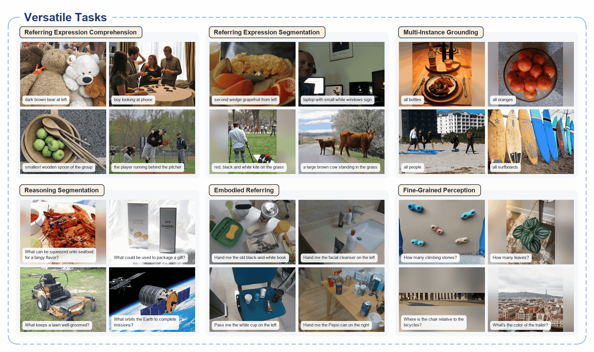

# CV-Bench 视觉空间理解评测总报告
### Xiaomi-Lens-0 vs. Qwen3.5-4B

> 整理日期：2026-11-02｜输入：**单张静态 RGB 图片**｜数据集：**CV-Bench Test（2,638 题）**｜模型：两个 4B 级 VLM  
> **数据说明：** 本文的“官方结果”来自模型发布方；“本地实测”来自项目保存的六组全量实验记录，二者不混用。未开展视频或连续帧评测。  
> **可移植性：** 本文所有图片、外部资料、代码和实验记录的 Markdown 链接均使用完整 HTTPS URL；仓库内引用固定到整理时的提交 `52a39ebe26a0`，复制此 MD 到其他平台时无需依赖原文件夹层级（展示图片仍需联网）。

## 1. 结论摘要

- **准确率：** 六组实验均已完成，每组 2,638 题。最高的本地 CV-Bench 官方加权分是 **Xiaomi-Lens-0 / Thinking Off（8192 上限）：87.76%**，Qwen3.5-4B 对应为 **86.76%**。
- **Thinking 并非越长越好：** 历史相同 Prompt、8192 Token 上限下，Xiaomi 开启 Thinking 后为 **87.29%**（−0.48 pp），Qwen 为 **85.34%**（−1.42 pp）；其中 Qwen 有 **172/2638（6.52%）** 的回答因思考过长而未能给出最终答案。
- **直接回答显著提速：** Direct Answer / Thinking Off（64 Token 上限）下，Xiaomi **87.04%、0.299 s/题**；Qwen **85.88%、0.334 s/题**。平均输出仅约 8～10 Token，但相较旧实验有约 0.7～0.9 pp 的分数下降。
- **任务差距：** 直接回答时，小米在物体计数（72.46% vs 69.42%）更突出；深度顺序也略优，而相对距离判断 Qwen 略优。
- **重要限制：** 历史 8192 与 Direct Answer 64 同时改变了 Prompt、输出长度上限及解析规则；不能将新旧成绩差异全部归因于 Thinking。共享 GPU 与不同推理后端也会影响速度比较。

## 2. 模型介绍与官方资料

| | Xiaomi-Lens-0 | Qwen3.5-4B |
|---|---|---|
| Hugging Face | [SeerRay-Lab/Xiaomi-Lens-0](https://huggingface.co/SeerRay-Lab/Xiaomi-Lens-0) | [Qwen/Qwen3.5-4B](https://huggingface.co/Qwen/Qwen3.5-4B) |
| 官方代码 / 说明 | [Xiaomi-Lens-0 官方仓库](https://github.com/SeerRay-Lab/Xiaomi-Lens-0) | [Qwen3.5-4B 模型卡与使用说明](https://huggingface.co/Qwen/Qwen3.5-4B) |
| 论文 / 技术资料 | [Xiaomi-Lens-0 Technical Report（arXiv:2610.23279）](https://arxiv.org/abs/2610.23279) | [Qwen3.5 官方技术介绍（Qwen Team 博客）](https://qwen.ai/blog?id=qwen3.5)；目前未将其他型号的技术报告冒充为 4B 专属论文 |
| 核心定位 | 基于 Qwen3.5-4B，增强**像素级定位、区域推理和分割**，可输出文本、BBox、Mask | 通用原生视觉语言模型，融合视觉编码与混合注意力语言主干，支持图像理解及多种多模态任务 |
| 参数量级 | 4B | 4B |

**官方公开的任务与指标（不是本地复测）：**

- **Xiaomi-Lens-0：** 官方评估涵盖指代表达理解、指代表达分割、多实例定位、推理分割、具身指代和细粒度感知；其技术报告称，在 RefCOCO 系列八个划分上的指代表达理解平均比对应的 Qwen3.5 基座高 **5.6 个百分点**。[官方论文](https://arxiv.org/abs/2610.23279)
- **Qwen3.5-4B：** 官方模型卡报告了通用 VQA、数学图像理解、OCR、空间智能及视频理解等任务；空间相关项目包括 CountBench、RefCOCO、EmbSpatialBench、RefSpatialBench 等。**这些不是本项目的 CV-Bench 成绩。** [官方模型卡](https://huggingface.co/Qwen/Qwen3.5-4B)

**官方演示 / 宣传素材：** [Xiaomi 官方展示视频](https://seerray-lab.github.io/Xiaomi-Lens-0/#video) · [Xiaomi 完整演示 MP4](https://raw.githubusercontent.com/chuiziTom/VLM-test/52a39ebe26a0af31e8a5e0dd039cb360bc1592aa/models/Xiaomi-Lens-0/docs/assets/video/xiaomi_lens_0_overview.mp4) · [Qwen3.5 官方介绍](https://qwen.ai/blog?id=qwen3.5)




## 3. 本地测试机器与部署

### 3.1 硬件与软件

| 项目 | 本地实测配置 |
|---|---|
| 操作系统 | Ubuntu 24.04.5 LTS / Linux 7.0.0-38-generic |
| GPU | **NVIDIA RTX PRO 6000 Blackwell Workstation Edition**（96 GB 级别；PyTorch 记录约 94.96 GiB 可见显存） |
| GPU 架构 | Blackwell，Compute Capability `sm_120` |
| NVIDIA 驱动 | `580.178.04`（驱动侧支持 CUDA 13.0） |
| PyTorch / CUDA Runtime | `2.10.0+cu128` / CUDA **12.8** |
| 精度、Batch Size | 两模型均为 BF16、Batch Size = 1、贪心解码 `do_sample=False` |
| CPU / 系统 RAM | 原始评测配置未统一记录，不在此推测 |

| 模型 | Micromamba 环境 | Transformers | Attention 后端 | 推理峰值 PyTorch allocated |
|---|---|---|---|---:|
| Xiaomi-Lens-0 | `xiaomi-lens` | 5.4.0 | `flash_attention_2` | 约 9.36 GiB |
| Qwen3.5-4B | `vlm-test` | 5.20.2 | `sdpa` | 约 9.22 GiB |

> 两个环境**不能混用**。模型权重位于服务器 Hugging Face 缓存，不包含在公开仓库。评测时 GPU 与其他任务共享；显存“allocated”是 PyTorch 统计，不等于整卡总占用。驱动支持的 CUDA 13.0 也不等于 PyTorch 实际使用的 CUDA 12.8 Runtime。

### 3.2 部署与评测脚本

| 用途 | 实现与入口 |
|---|---|
| Xiaomi 官方单图推理（可输出 Mask / BBox） | [官方 `infer.py`（本项目源码副本）](https://github.com/chuiziTom/VLM-test/blob/52a39ebe26a0af31e8a5e0dd039cb360bc1592aa/models/Xiaomi-Lens-0/infer.py) |
| Qwen 官方 Transformers 推理 | [官方模型卡 Quickstart](https://huggingface.co/Qwen/Qwen3.5-4B) |
| Xiaomi 本地模型适配 | [`xiaomi_lens_adapter.py`](https://github.com/chuiziTom/VLM-test/blob/52a39ebe26a0af31e8a5e0dd039cb360bc1592aa/evaluation/xiaomi_lens/xiaomi_lens_adapter.py) |
| Qwen 本地模型适配 | [`model_qwen35.py`](https://github.com/chuiziTom/VLM-test/blob/52a39ebe26a0af31e8a5e0dd039cb360bc1592aa/evaluation/qwen35_4b/model_qwen35.py) |
| 历史 8192 实验入口 | [Xiaomi](https://github.com/chuiziTom/VLM-test/blob/52a39ebe26a0af31e8a5e0dd039cb360bc1592aa/evaluation/xiaomi_lens/run_evaluation.py) / [Qwen](https://github.com/chuiziTom/VLM-test/blob/52a39ebe26a0af31e8a5e0dd039cb360bc1592aa/evaluation/qwen35_4b/run_qwen35_cvbench.py) |
| Direct Answer 实验入口 | [Xiaomi](https://github.com/chuiziTom/VLM-test/blob/52a39ebe26a0af31e8a5e0dd039cb360bc1592aa/evaluation/direct_answer/run_xiaomi_direct_answer.py) / [Qwen](https://github.com/chuiziTom/VLM-test/blob/52a39ebe26a0af31e8a5e0dd039cb360bc1592aa/evaluation/direct_answer/run_qwen35_direct_answer.py) |
| 环境配置细节 | [`docs/environment_setup.md`](https://github.com/chuiziTom/VLM-test/blob/52a39ebe26a0af31e8a5e0dd039cb360bc1592aa/docs/environment_setup.md) / [模型清单](https://github.com/chuiziTom/VLM-test/blob/52a39ebe26a0af31e8a5e0dd039cb360bc1592aa/docs/models.md) |

本地验证已有结果（无需重新下载模型或重跑 2,638 题）：

```bash
cd /home/20261024_1/Workspace/qyh/VLM-test

micromamba run -n vlm-test python -B analysis/legacy_8192/verify_results.py
micromamba run -n vlm-test python -B analysis/direct_answer_64_v1/verify_and_compare.py
```

## 4. 数据集与测试任务

**[CV-Bench（Hugging Face）](https://huggingface.co/datasets/nyu-visionx/CV-Bench)** 来自 [Cambrian-1 论文（arXiv:2406.16860）](https://arxiv.org/abs/2406.16860)，将 ADE20K、COCO、Omni3D 的视觉标注整理成 **2,638 条人工检查的图像选择题**，测试模型对单张图片的 2D / 3D 视觉空间理解能力。

| 子任务 | 考察内容 | 来源 | 题数 |
|---|---|---|---:|
| 2D / Count | 物体数量：图中有几个指定物体？ | ADE20K、COCO | 788 |
| 2D / Relation | 平面关系：左 / 右 / 上 / 下等 | ADE20K、COCO | 650 |
| 3D / Depth | 深度顺序：哪一个物体更靠近相机？ | Omni3D | 600 |
| 3D / Distance | 相对距离：哪个物体距离指定物体更近？ | Omni3D | 600 |
| **总计** | **2D：1,438；3D：1,200** | | **2,638** |

**样本示例：** 以下图像从本项目保存的 CV-Bench 样例中提取，不是模型生成结果。


> **2D 示例题：** “How many dividers are in the image?”（计数）；“Where is the bus located with respect to the truck?”（二维关系）。


> **3D 示例题：** “Which object is closer to the camera, the table or the lamp?”（深度顺序）；“Which object is closer to the truck, the trailer or the barrier?”（相对距离）。

[2D 样本标注](https://github.com/chuiziTom/VLM-test/blob/52a39ebe26a0af31e8a5e0dd039cb360bc1592aa/datasets/CV-Bench/samples/2D/annotations.csv) · [3D 样本标注](https://github.com/chuiziTom/VLM-test/blob/52a39ebe26a0af31e8a5e0dd039cb360bc1592aa/datasets/CV-Bench/samples/3D/annotations.csv)

**测试范围：** 本项目只完成**静态 RGB 图片 + 问题 + 候选选项**输入；未进行连续帧、视频、时序记忆等任务，因此不评价模型的视频空间理解能力。即使 Xiaomi 模型支持 Mask 输出，本次 CV-Bench 也只评分最终选择题答案，不评估分割质量。

## 5. 测试方法

**流程：** Parquet 中读取图像 / 问题 / 选项 → 各模型 Processor + Chat Template → GPU 贪心生成 → 严格解析最终选项 → 与 Ground Truth 对比 → 统计分任务准确率、耗时、Token、显存。

| 实验协议 | Thinking | `max_new_tokens` | 输出要求与区别 |
|---|---|---:|---|
| 历史长回答（Legacy） | Off | 8192 | 可有回答说明；最终必须包含 `FINAL_ANSWER: (X)` |
| 历史长回答（Legacy） | On | 8192 | 显式生成 `<think>…</think>` 后，在最终回答区解析选项 |
| 直接回答（Direct Answer v1） | Off | 64 | 只准输出一行 `FINAL_ANSWER: (X)`，禁止额外分析文字 |

两个模型使用各自模板的 `enable_thinking=True/False` 控制显式 Thinking。**8192 和 64 都是生成上限，不是每题固定输出的 Token 数。** Direct Answer 两模型使用同一 Prompt，历史 Off / On 使用同一历史 Prompt；标准答案不进入模型输入。

**解析规则：** 只解码新生成的 Token；历史实验只从最终回答区提取格式正确的 `FINAL_ANSWER: (X)` 行；Direct Answer 要求整段严格匹配这一格式，选项字母必须属于当前题目的合法集合。无效输出、格式违规和截断均计为错误，保留在分母中，不根据文本含义事后补答案。

**CV-Bench 官方加权评分：**

```text
2D = (Accuracy_ADE20K + Accuracy_COCO) / 2
3D = Accuracy_Omni3D
CV-Bench = (2D + 3D) / 2
```

这与全部 2,638 题直接平均的“普通 Accuracy”略有不同，下文以**官方加权分**为主要结论。

## 6. 本地实测结果

### 6.1 六组实验总览

| 模型 | 协议 | **官方 CV-Bench** | 官方 2D | 3D | 普通 Accuracy |
|---|---|---:|---:|---:|---:|
| **Xiaomi-Lens-0** | Thinking Off / 8192 | **87.76%** | 83.44% | 92.08% | 87.76% |
| Xiaomi-Lens-0 | Thinking On / 8192 | 87.29% | 83.41% | 91.17% | 87.23% |
| Xiaomi-Lens-0 | Direct Answer Off / 64 | **87.04%** | 82.17% | 91.92% | 86.92% |
| **Qwen3.5-4B** | Thinking Off / 8192 | **86.76%** | 82.27% | 91.25% | 86.73% |
| Qwen3.5-4B | Thinking On / 8192 | 85.34% | 79.09% | 91.58% | 85.14% |
| Qwen3.5-4B | Direct Answer Off / 64 | **85.88%** | 80.26% | 91.50% | 85.63% |

每一行均对应全量 **2,638 / 2,638** 题，所有运行状态为 completed；不是抽样成绩。官方总分可通过上面的公式从各来源准确率复算。

### 6.2 细分任务：Direct Answer 两模型对比

| 任务 | Xiaomi-Lens-0 | Qwen3.5-4B | 差值（Xiaomi − Qwen） |
|---|---:|---:|---:|
| Object Counting（788） | **72.46%** | 69.42% | +3.05 pp |
| Spatial Relation（650） | **95.23%** | 94.46% | +0.77 pp |
| Depth Order（600） | **96.17%** | 94.83% | +1.33 pp |
| Relative Distance（600） | 87.67% | **88.17%** | −0.50 pp |

在 Direct Answer 下，Xiaomi 官方总分高 1.16 pp；逐题配对比较为仅 Xiaomi 答对 111 题、仅 Qwen 答对 77 题（McNemar 精确检验 p = 0.0159）。优势主要来自物体计数，尤其是 COCO 来源的计数题。

### 6.3 推理速度、Token 与稳定性

| 模型 | 协议 | **平均端到端耗时** | P95 耗时 | 平均生成 Token | 平均 Thinking Token | Invalid / 截断 |
|---|---|---:|---:|---:|---:|---:|
| Xiaomi | Off / 8192 | 4.98 s | 12.42 s | 137.24 | 0 | 9 / 7 |
| Xiaomi | On / 8192 | 19.58 s | 65.45 s | 417.44 | 302.26 | 26 / 11 |
| Xiaomi | Direct Off / 64 | **0.299 s** | 0.404 s | **8.00** | 0 | **0 / 0** |
| Qwen | Off / 8192 | 10.64 s | 35.71 s | 118.56 | 0 | 1 / 0 |
| Qwen | On / 8192 | 37.13 s | 214.31 s | 1,365.24 | 1,301.77 | **172 / 172** |
| Qwen | Direct Off / 64 | **0.334 s** | 0.401 s | **9.98** | 0 | 24 / 0 |

> “Invalid / 截断”是两项统计，**截断可包含在 Invalid 内**，不可直接相加。Qwen Direct 的 24 条无效输出是格式违规，而非超出 64 Token 上限。端到端耗时不包含一次性的模型加载；GPU 共享、Attention 后端和软件版本差异使**跨模型速度排名仅供参考**。

**相对各自历史 Off（8192），Direct Answer 的变化：**

| 模型 | 平均 Token | 平均端到端耗时 | 官方分变化 |
|---|---|---|---|
| Xiaomi | 137.24 → 8.00（约 −94%） | 4.98 → 0.299 s（约 −94%） | −0.72 pp |
| Qwen | 118.56 → 9.98（约 −92%） | 10.64 → 0.334 s（约 −97%） | −0.88 pp |

上述加速是**改变输出协议后的观察结果**，不等于“仅关闭 Thinking”的因果效果，因为历史 Off 已经是 `enable_thinking=False`；Direct Answer 的主要变化是**禁止解释和限制答案形式**。

### 6.4 实测日志 / 截图补充区

本报告的表格直接来自原始指标文件，未伪造模型输出截图。后续可在此补充：

- 典型正确 / 错误案例的图片与预测文字；
- Thinking On 的长推理或截断日志；
- Direct Answer 的原始回答与解析结果截图。

## 7. 分析与局限

**观察到的现象：** Xiaomi 在本次三种配置下的官方总分均高于 Qwen，但两者在部分 3D 任务接近。显式 Thinking 增加了延迟与生成长度，却未提升当前完整评测的官方总分；Qwen Thinking On 的较高截断率是其主要失分来源之一。直接回答大幅降低输出成本，但对格式约束和任务类型存在敏感性。

**不能得出的结论：**

1. 不能说 Thinking 一定降低空间推理能力：Qwen Thinking On 的有效输出子集表现并不差，但把 172 条无法按时给出最终答案的样本排除后，会造成选择偏差。
2. 不能把 Direct Answer 的提速归因于 Thinking Off：历史 Off 本身已关闭显式 Thinking，新实验还改变了 Prompt、输出格式、长度上限和解析策略。
3. 不能把“未输出思考文本”等同于“模型内部不进行推理”。
4. 不能由单一 CV-Bench 静态图片结果推广到视频、空间记忆、VLN 或机器人执行能力。
5. 不能把本地共享 GPU 下的时延当作模型在相同独占条件下的严格性能排名。

**后续优先方向：** 在固定 Prompt / 解析规则下做单因素 Thinking 消融；独占 GPU 复测速度；分析 Count 与 Distance 的错误类型，再考虑扩展至 SPAR-Bench、VSI-Bench 的多视角 / 视频任务。

## 8. 原始结果与复核依据

| 数据与文档 | 固定版本的完整链接 |
|---|---|
| 历史 Off / On 双模型详细报告 | [Legacy 8192 比较](https://github.com/chuiziTom/VLM-test/blob/52a39ebe26a0af31e8a5e0dd039cb360bc1592aa/reports/legacy_8192/cvbench_qwen35_xiaomi_comparison.md) |
| Direct Answer 双模型详细报告 | [Direct Answer 比较](https://github.com/chuiziTom/VLM-test/blob/52a39ebe26a0af31e8a5e0dd039cb360bc1592aa/reports/direct_answer_64_v1/cvbench_direct_answer_comparison.md) |
| Xiaomi Direct Answer 详细报告 | [Xiaomi 单模型报告](https://github.com/chuiziTom/VLM-test/blob/52a39ebe26a0af31e8a5e0dd039cb360bc1592aa/reports/direct_answer_64_v1/xiaomi_lens_direct_answer_report.md) |
| Qwen Direct Answer 详细报告 | [Qwen 单模型报告](https://github.com/chuiziTom/VLM-test/blob/52a39ebe26a0af31e8a5e0dd039cb360bc1592aa/reports/direct_answer_64_v1/qwen35_4b_direct_answer_report.md) |
| 六组实验配置及指标路径 | [`EXPERIMENT_INDEX.md`](https://github.com/chuiziTom/VLM-test/blob/52a39ebe26a0af31e8a5e0dd039cb360bc1592aa/EXPERIMENT_INDEX.md) / [`experiment_manifest.json`](https://github.com/chuiziTom/VLM-test/blob/52a39ebe26a0af31e8a5e0dd039cb360bc1592aa/experiment_manifest.json) |
| Xiaomi / Qwen 历史数据 | [Xiaomi 两种 Thinking 结果](https://github.com/chuiziTom/VLM-test/blob/52a39ebe26a0af31e8a5e0dd039cb360bc1592aa/experiments/cv_bench/legacy_8192/xiaomi_lens) / [Qwen 两种 Thinking 结果](https://github.com/chuiziTom/VLM-test/blob/52a39ebe26a0af31e8a5e0dd039cb360bc1592aa/experiments/cv_bench/legacy_8192/qwen35_4b) |
| Xiaomi / Qwen Direct 数据 | [Xiaomi 结果](https://github.com/chuiziTom/VLM-test/blob/52a39ebe26a0af31e8a5e0dd039cb360bc1592aa/experiments/cv_bench/direct_answer_64_v1/xiaomi_lens) / [Qwen 结果](https://github.com/chuiziTom/VLM-test/blob/52a39ebe26a0af31e8a5e0dd039cb360bc1592aa/experiments/cv_bench/direct_answer_64_v1/qwen35_4b) |
| 复核代码 | [Legacy 复核](https://github.com/chuiziTom/VLM-test/blob/52a39ebe26a0af31e8a5e0dd039cb360bc1592aa/analysis/legacy_8192/verify_results.py) / [Direct 复核](https://github.com/chuiziTom/VLM-test/blob/52a39ebe26a0af31e8a5e0dd039cb360bc1592aa/analysis/direct_answer_64_v1/verify_and_compare.py) |

**报告性质：** 六组已完成实验的集中归档总结；没有重新运行推理，也没有修改原始预测、环境或模型权重。
