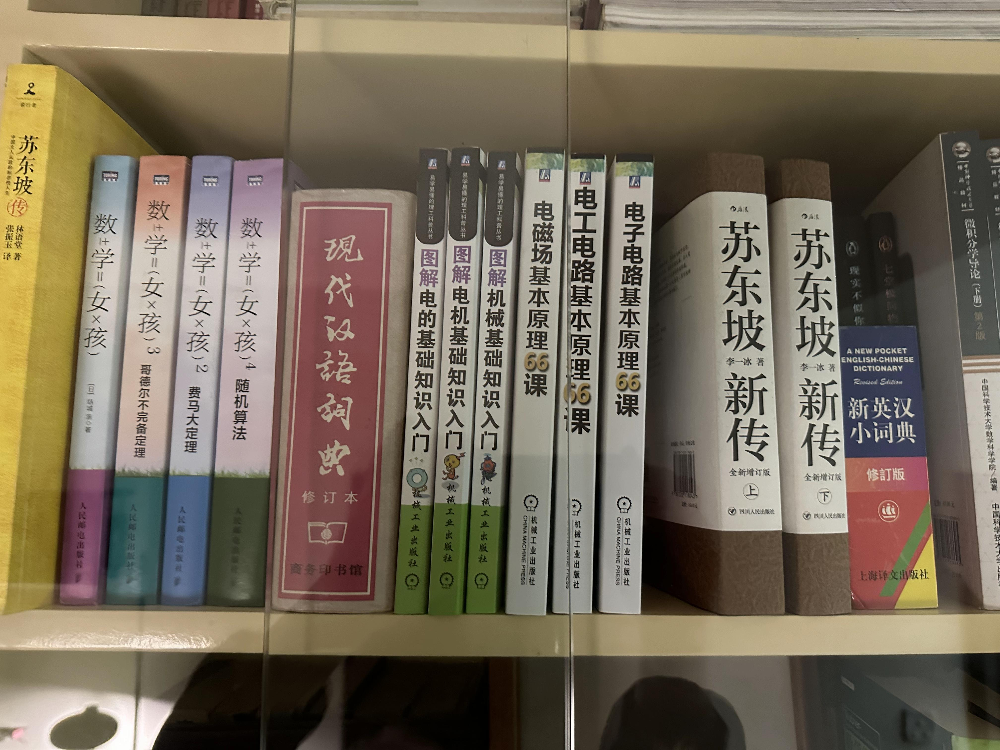

# 几何理解简单测试报告：Qwen3.5-4B 与 Xiaomi-Lens-0

> 测试日期：2026-11-03  
> 测试性质：自定义图片上的定性探索实验（不是标准 Benchmark）  
> 当前覆盖：几何测试 1、几何测试 5；几何测试 2、3、4 尚未测试。

## 1. 测试范围与目标

本次测试关注两类能力：

- **规则网格定位**：根据行、列坐标找到指定书籍，并识别书脊颜色和书名。
- **长序列计数与定位**：从左到右数出第 14 本书，再识别其颜色、书名和位置。

测试图片位于 [datasets/几何简单测试](../datasets/几何简单测试/)。仓库目前包含 5 张图片，本次只测试第 1 张和第 5 张。选择第 5 张是因为它包含较多相邻书籍，需要连续计数并区分相似的白色书脊。

### 人工核对的目标答案

| 图片 | 图片 | 测试问题 | 按图片核对的目标 |
|---|---|---|---|
| 几何测试 1 |  | 第 2 行、第 2 列的书是什么颜色、什么书？ | 白色/米白色书脊，书名 **Music**；位置为第 2 行、第 2 列。 |
| 几何测试 5 |  | 从最左侧黄色书开始计数，第 14 本是什么书？ | 白色书脊，**《苏东坡新传（下）》**；图片中可见一排书，目标是从左数第 14 本。蓝色《新英汉小词典》在其右侧，是第 15 本。 |

## 2. 模型与运行配置

| 项目 | Qwen3.5-4B | Xiaomi-Lens-0 |
|---|---|---|
| 模型 ID | <code>Qwen/Qwen3.5-4B</code> | <code>SeerRay-Lab/Xiaomi-Lens-0</code> |
| Micromamba 环境 | <code>vlm-test</code> | <code>xiaomi-lens</code> |
| 调用方式 | Transformers：<code>AutoProcessor</code> + <code>AutoModelForMultimodalLM</code> | 复用 <code>evaluation/cv-bench/xiaomi_lens/xiaomi_lens_adapter.py</code> 中的 <code>XiaomiLensAdapter</code> |
| 精度 / 设备 | BF16，<code>device_map="auto"</code> | BF16，<code>cuda:0</code> |
| Attention | Notebook 未记录实际后端 | <code>flash_attention_2</code> |
| 模型加载时间 | 未单独计时（Notebook 显示权重加载完成，但没有正式计时值） | **4.997 s** |
| 加载后显存 | 未记录 | PyTorch allocated **17.42 GiB**；整卡使用约 **25.13 / 94.96 GiB** |

Xiaomi 权重实际从本地缓存加载，Notebook 记录的快照路径为：

<code>/home/20261024_1/.cache/huggingface/hub/models--SeerRay-Lab--Xiaomi-Lens-0/snapshots/68f57cdde1a19f751e78b18af04efa8ca8bd7fce</code>

### Thinking 与生成参数核对

- **Qwen**：本 Notebook 已执行的推理单元格均传入 <code>enable_thinking=False</code>。其中一个 Markdown 标题写着“中文 + 思考模式”，但该单元格代码实际仍是 <code>enable_thinking=False</code>，且 <code>do_sample=True</code>。因此它不是有效的 Thinking On 实验，不能把它的结果记作 Qwen Thinking On。
- **Xiaomi**：通过 Adapter 的 <code>mode="off"</code> / <code>mode="on"</code> 控制 Thinking，并检查 <code>mode_verified=True</code>。本次确实执行了几何测试 5 的 Thinking On。
- **最大生成长度**：本次 Notebook 中 Qwen 的生成调用使用 <code>max_new_tokens=2048</code>；Xiaomi 的 <code>test_xiaomi()</code> 默认也是 <code>max_new_tokens=2048</code>。
- **Direct Answer 的含义**：本次所谓“直接回答”是 Prompt 里增加“直接输出答案，不要输出分析过程”的文字指令，**不是** <code>max_new_tokens=64</code>。本次没有执行 64-token 上限实验。
- Qwen 除一条特别注明的采样测试外使用 <code>do_sample=False</code>；Xiaomi Adapter 使用贪心生成。Qwen 的 <code>temperature/top_p/top_k</code> 在 <code>do_sample=False</code> 时不构成实际采样控制。

## 3. 几何测试 1：规则二维网格

目标：第 2 行、第 2 列，白色/米白色书脊，书名 Music。

| 模型 | 提示语言 / 协议 | 实际调用与关键参数 | 模型回答摘要 | 判断 | 生成 Token | 生成耗时 | Token/s | Peak allocated VRAM |
|---|---|---|---|---|---:|---:|---:|---:|
| Qwen3.5-4B | 中文 / Off | <code>enable_thinking=False</code>；<code>generate(max_new_tokens=2048, do_sample=False)</code> | “第 2 行、第 2 列……《Music》”；白色/米白色。 | 正确 | 76 | 2.119 s | 35.86 | 未记录 |
| Qwen3.5-4B | 中文 / Off + 直接回答指令 | 同上；Prompt 末尾增加“请直接输出答案，而不要输出你的分析过程” | “白色；书名 Music；第 2 行、第 2 列”。 | 正确 | 40 | 1.163 s | 34.40 | 未记录 |
| Xiaomi-Lens-0 | 中文 / Off | <code>test_xiaomi(image, question, mode="off")</code>；默认 <code>max_new_tokens=2048</code> | “第 2 行、第 2 列的书是《Music》”；白色/米白色。 | 正确 | 82 | 2.267 s | 36.18 | 17.79 GiB |
| Xiaomi-Lens-0 | 中文 / Off + 直接回答指令 | <code>test_xiaomi(image, question, mode="off")</code>；Prompt 增加直接回答要求 | “白色；Music；第 2 行、第 2 列”。 | 正确 | 39 | 1.134 s | 34.38 | 17.80 GiB |

**观察：** 两个模型在这张规则网格图片上均能正确完成行列定位、颜色识别和书名识别。加入直接回答指令后，两者生成 Token 和耗时均下降；但这只是单次样本结果，不代表稳定的速度提升。

## 4. 几何测试 5：长序列计数与定位

目标：从左侧黄色书开始数，第 14 本为白色书脊的《苏东坡新传（下）》。图片中只有一排书；蓝色《新英汉小词典》是第 15 本。

| 模型 | 提示语言 / 实际模式 | 实际调用与关键参数 | 模型回答摘要 | 判断 | 生成 Token | 生成耗时 | Token/s | Peak allocated VRAM |
|---|---|---|---|---|---:|---:|---:|---:|
| Qwen3.5-4B | 中文 / Off | <code>enable_thinking=False</code>；<code>generate(max_new_tokens=2048, do_sample=False)</code> | 回答《苏东坡新传（下）》、白色；但把位置说成“中间行”，图片实际只有一排。 | 目标书与颜色正确；行描述错误 | 76 | 3.685 s | 20.62 | 未记录 |
| Qwen3.5-4B | 中文 / **实际 Off + Sampling** | Notebook Markdown 标注“思考模式”，但代码是 <code>enable_thinking=False</code>、<code>do_sample=True</code>、<code>temperature=1.0</code>、<code>top_p=0.95</code>、<code>top_k=20</code> | 列举时将第 14 本识别为《苏东坡新传（下）》；最终答案只写“苏东坡新传”，位置描述为“最右边一排的第 2 本”。 | 部分正确；不是 Thinking On，最终位置描述不正确 | 415 | 12.902 s | 32.16 | 未记录 |
| Qwen3.5-4B | 英文 / Off | <code>enable_thinking=False</code>；<code>generate(max_new_tokens=2048, do_sample=False)</code> | 识别白色书脊和第 14 本，但将书名版本说成《苏东坡新传（上）》。 | 书籍版本识别错误 | 178 | 5.962 s | 29.86 | 未记录 |
| Qwen3.5-4B | 英文 / Off + 直接回答指令 | 同上；Prompt 增加直接回答要求 | 回答《苏东坡新传（上）》，并称位于“第二行、第 7 列”。 | 目标书名和位置均错误 | 47 | 2.529 s | 18.58 | 未记录 |
| Xiaomi-Lens-0 | 中文 / Off | <code>test_xiaomi(image, question, mode="off")</code>；默认 <code>max_new_tokens=2048</code> | 将第 14 本回答为蓝色《新英汉小词典》。它实际是第 15 本；输出的枚举还漏掉了一本数学书。 | 计数错误，目标定位错误 | 280 | 8.164 s | 34.30 | 19.02 GiB |
| Xiaomi-Lens-0 | 中文 / On | <code>test_xiaomi(image, question, mode="on")</code>；<code>mode_verified=True</code>；默认 <code>max_new_tokens=2048</code> | 最终回答为白色书脊《苏东坡新传》，位置为第一排第 14 本；没有在最终答案中明确区分“上/下”。 | 位置与颜色正确；书名版本信息不完整 | 505（Thinking 458 / Answer 46） | 14.237 s | 35.47 | 19.02 GiB |
| Xiaomi-Lens-0 | 英文 / Off | <code>test_xiaomi(image, question, mode="off")</code>；默认 <code>max_new_tokens=2048</code> | 回答白色书脊《苏东坡新传（下）》，位于唯一一排、从左数第 14 本。 | 正确 | 508 | 14.391 s | 35.30 | 19.03 GiB |
| Xiaomi-Lens-0 | 英文 / Off + 直接回答指令 | 同上；Prompt 增加直接回答要求 | 回答《电子电路基本原理66课》，并称位于“第二行、第 4 列”。 | 目标书籍和位置均错误 | 43 | 1.814 s | 23.71 | 19.03 GiB |

**观察：**

1. 测试 5 比测试 1 困难得多。模型需要连续数出多个相邻书籍，并区分《苏东坡新传（上）》和《苏东坡新传（下）》。
2. Qwen 中文 Off 找到了正确书籍，但位置描述中的“中间行”不符合图片结构；英文 Off 则把上下册混淆。直接回答指令没有修复该错误。
3. Xiaomi 中文 Off 漏数了一本数学书，导致把第 15 本蓝色词典当成第 14 本；英文 Off 则正确找到《苏东坡新传（下）》。
4. 两个模型在测试 5 上都出现了对 Prompt 语言或输出约束敏感的现象。尤其是直接回答指令并不保证结果更准确：Xiaomi 英文直接回答和 Qwen 英文直接回答均出现了明显定位错误。
5. Xiaomi Thinking On 的最终答案没有区分上下册；虽然位置与颜色正确，但不能将其记为完全正确的书名识别。

## 5. 性能指标说明与限制

- **生成耗时**：围绕 <code>model.generate()</code> / Adapter <code>generate()</code> 测量，并在 CUDA 计时前后同步；不包含模型加载和图片预处理。
- **Token/s**：生成 Token 数除以生成耗时，包含生成调用的整体开销，不是纯 Decode 阶段速度。
- **Peak allocated VRAM**：Notebook 中 Xiaomi Adapter 记录的 PyTorch 单次生成峰值 allocated 显存；不是整张 GPU 的总显存占用。
- **Qwen 显存**：当前 Notebook 没有记录显存，因此留空，不推测或用 Xiaomi 的数据代替。
- **模型加载时间**：Xiaomi 记录为 4.997 s；Qwen 没有单独计时。
- 每种输入配置目前只有单次运行记录，没有重复实验和独立预热。因此速度数据仅作本次运行参考，不适合用于严谨的跨模型性能排名。
- 本次测试没有统一固定所有 Prompt：中文/英文、直接回答指令和生成模式均有变化。因此结果适合定性观察，不是严格控制变量实验。

## 6. 当前结论

- **规则网格定位（测试 1）**：Qwen3.5-4B 和 Xiaomi-Lens-0 均能正确识别第 2 行、第 2 列的白色《Music》。
- **长序列计数（测试 5）**：两模型都表现出不稳定性。Qwen 在上下册区分和位置描述上出现错误；Xiaomi 中文 Off 出现漏数，英文 Off 能正确回答，而直接回答指令下反而定位失败。
- **Thinking 的影响**：Xiaomi 有一次经过 Adapter 验证的 Thinking On 测试；Qwen 当前 Notebook 没有真正执行 <code>enable_thinking=True</code>，因此不能据此比较两模型的 Thinking On/Off。Qwen 那条被标注为“思考模式”的记录实际是 Off + Sampling。
- **Direct Answer 的影响**：本次只测试了 Prompt 直接回答指令，没有测试 64-token 上限。直接回答并不必然提升定位准确率。

这组测试只能说明两个模型在这两张自定义书架图片上的表现，不能据此推断它们在一般几何理解、复杂空间推理或 UAV-VLN 导航任务上的整体能力。

## 7. 原始记录与图片

- Qwen Notebook：[evaluation/几何理解简单测试/qwen3.5-4B.ipynb](../evaluation/几何理解简单测试/qwen3.5-4B.ipynb)
- Xiaomi Notebook：[evaluation/几何理解简单测试/xiaomi-lens-0.ipynb](../evaluation/几何理解简单测试/xiaomi-lens-0.ipynb)
- 图片目录：[datasets/几何简单测试](../datasets/几何简单测试/)

本报告中的回答摘要和性能数字均整理自上述 Notebook 已保存的执行输出；未执行的测试没有补造结果。
