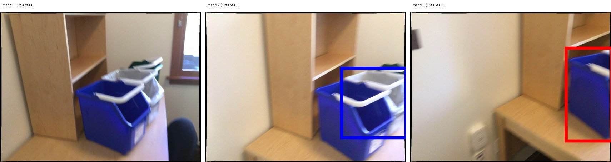
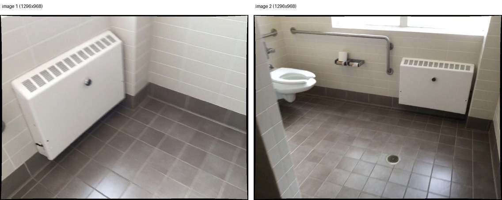
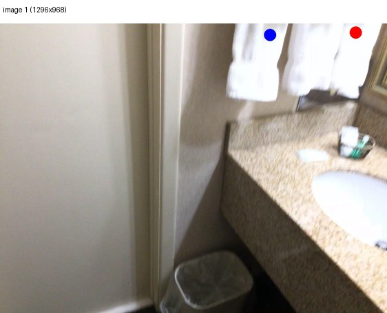

# SPAR-Bench-Tiny 数据集检查报告

> 本报告的全部统计均由本地 Parquet 实测得到；官方 Dataset Card 的数字只作为对照，不作为本地结论。

## 1. 数据来源与版本

| 项目 | 内容 |
|---|---|
| 数据集 | SPAR-Bench-Tiny（RGB，仅 Tiny 版本） |
| 本地目录 | `/home/20261024_1/Workspace/qyh/VLM-test/datasets/SPAR-Bench-Tiny` |
| Parquet | `/home/20261024_1/Workspace/qyh/VLM-test/datasets/SPAR-Bench-Tiny/data/test-00000-of-00001.parquet` |
| 文件大小 | 185.0 MiB |
| SHA-256 | `aa54325a05c494f3a4b47366be7cf11bd540e96f8aadfcba2c7b2f8aa63ccca8` |
| Dataset Card | https://huggingface.co/datasets/jasonzhango/SPAR-Bench-Tiny |
| 完整 Benchmark | https://huggingface.co/datasets/jasonzhango/SPAR-Bench |
| 官方代码 | https://github.com/LogosIntelligenceLab/SPAR |
| 论文 | https://arxiv.org/abs/2503.22976 |

本次只评测 **SPAR-Bench-Tiny RGB**，不包含 RGB-D 版本，也不混入完整 SPAR-Bench 的数据。

## 2. 结构检查

| 检查项 | 结果 |
|---|---|
| Parquet 文件数 | 1 |
| 总样本数 | 1000 |
| 唯一 ID 数 | 1000 |
| 重复 ID | 0 个 |
| 缺失字段 | 0 处 |
| 图片解码失败 | 0 条 |
| 实际任务种类 | 20 |
| 未知任务 | 无 |
| 官方任务缺失 | 无 |
| 图片来源 | scannet (1000) |
| 图片尺寸范围 | [640, 480] ~ [1296, 968] (W×H) |

字段结构：`id`(int64), `img_type`(str), `format_type`(str), `task`(str), `source`(str), `image`(list<struct<bytes,path>>), `question`(str), `answer`(str)。图片直接以二进制存储在 Parquet 中，每条样本包含 1~3 张。

## 3. 任务分布（20 种）

| 任务 | 层级 | 评分方式 | 样本数 | 输入类型 | 答案格式 | 图片数分布 |
|---|---|---|---:|---|---|---|
| `depth_prediction_oc` | low | NA | 50 | single_view:50 | fill:50 | 1张:50 |
| `depth_prediction_oo` | low | NA | 50 | single_view:50 | fill:50 | 1张:50 |
| `distance_prediction_oc` | low | NA | 50 | single_view:50 | fill:50 | 1张:50 |
| `distance_prediction_oo` | low | NA | 50 | single_view:50 | fill:50 | 1张:50 |
| `depth_prediction_oc_mv` | low | NA | 50 | multi_view:50 | fill:50 | 3张:50 |
| `depth_prediction_oo_mv` | low | NA | 50 | multi_view:50 | fill:50 | 3张:50 |
| `distance_prediction_oo_mv` | low | NA | 50 | multi_view:50 | fill:50 | 3张:50 |
| `distance_prediction_oc_mv` | low | NA | 50 | multi_view:50 | fill:50 | 3张:50 |
| `view_change_infer` | medium | VCI | 50 | multi_view:50 | fill:50 | 2张:50 |
| `position_matching` | medium | MCA | 50 | multi_view:50 | select:50 | 2张:50 |
| `camera_motion_infer` | medium | MCA | 50 | multi_view:50 | select:50 | 2张:50 |
| `obj_spatial_relation_oo` | high | MCA | 50 | single_view:50 | select:50 | 1张:50 |
| `obj_spatial_relation_oc_mv` | high | MCA | 50 | multi_view:50 | select:50 | 3张:50 |
| `obj_spatial_relation_oo_mv` | high | MCA | 50 | multi_view:50 | select:50 | 3张:50 |
| `spatial_imagination_oc` | high | MCA | 50 | single_view:50 | select:50 | 1张:50 |
| `spatial_imagination_oo` | high | MCA | 50 | single_view:50 | select:50 | 1张:50 |
| `spatial_imagination_oc_mv` | high | MCA | 50 | multi_view:50 | select:50 | 3张:50 |
| `spatial_imagination_oo_mv` | high | MCA | 50 | multi_view:50 | select:50 | 3张:50 |
| `distance_infer_center_oo` | high | MCA | 50 | single_view:50 | select:50 | 1张:50 |
| `distance_infer_center_oo_mv` | high | MCA | 50 | multi_view:50 | select:50 | 3张:50 |

### 层级分布

| 层级 | 任务数 | 样本数 | 任务列表 |
|---|---:|---:|---|
| Low | 8 | 400 | `depth_prediction_oc`, `depth_prediction_oo`, `distance_prediction_oc`, `distance_prediction_oo`, `depth_prediction_oc_mv`, `depth_prediction_oo_mv`, `distance_prediction_oo_mv`, `distance_prediction_oc_mv` |
| Medium | 3 | 150 | `view_change_infer`, `position_matching`, `camera_motion_infer` |
| High | 9 | 450 | `obj_spatial_relation_oo`, `obj_spatial_relation_oc_mv`, `obj_spatial_relation_oo_mv`, `spatial_imagination_oc`, `spatial_imagination_oo`, `spatial_imagination_oc_mv`, `spatial_imagination_oo_mv`, `distance_infer_center_oo`, `distance_infer_center_oo_mv` |

## 4. 输入类型与答案格式

| 维度 | 类别 | 样本数 | 占比 |
|---|---|---:|---:|
| 输入类型 | multi_view | 600 | 60.0% |
| 输入类型 | single_view | 400 | 40.0% |
| 每样本图片数 | 3 张 | 450 | 45.0% |
| 每样本图片数 | 1 张 | 400 | 40.0% |
| 每样本图片数 | 2 张 | 150 | 15.0% |
| 答案格式 | select | 550 | 55.0% |
| 答案格式 | fill | 450 | 45.0% |

**Single-view 400 条，Multi-view 600 条。** Multi-view 样本的 2~3 张图片在评测中全部按原始顺序输入模型。

### task × img_type × format_type

| 任务 | 输入类型 | 答案格式 | 样本数 |
|---|---|---|---:|
| `camera_motion_infer` | multi_view | select | 50 |
| `depth_prediction_oc` | single_view | fill | 50 |
| `depth_prediction_oc_mv` | multi_view | fill | 50 |
| `depth_prediction_oo` | single_view | fill | 50 |
| `depth_prediction_oo_mv` | multi_view | fill | 50 |
| `distance_infer_center_oo` | single_view | select | 50 |
| `distance_infer_center_oo_mv` | multi_view | select | 50 |
| `distance_prediction_oc` | single_view | fill | 50 |
| `distance_prediction_oc_mv` | multi_view | fill | 50 |
| `distance_prediction_oo` | single_view | fill | 50 |
| `distance_prediction_oo_mv` | multi_view | fill | 50 |
| `obj_spatial_relation_oc_mv` | multi_view | select | 50 |
| `obj_spatial_relation_oo` | single_view | select | 50 |
| `obj_spatial_relation_oo_mv` | multi_view | select | 50 |
| `position_matching` | multi_view | select | 50 |
| `spatial_imagination_oc` | single_view | select | 50 |
| `spatial_imagination_oc_mv` | multi_view | select | 50 |
| `spatial_imagination_oo` | single_view | select | 50 |
| `spatial_imagination_oo_mv` | multi_view | select | 50 |
| `view_change_infer` | multi_view | fill | 50 |

## 5. 多视角样本示例

### 三图选择题（obj_spatial_relation_oo_mv）

- 图片数量：3
- 问题：What is the spatial position of the recycling bin (red bbox) relative to the compost bin (blue bbox) in the two images, from the observer’s perspective? Calculate or judge based on the 3D center points of these objects. To illustrate the observer's perspective, we designate the first image as the main focus.
The options describe the spatial relationship between two objects in terms of left-right (left, right, or empty if indistinguishable), above-below (above, below, or empty if indistinguishable), closer-farther (closer, farther, or empty if indistinguishable), the first object is in front of or behind the observer (front, behind, or empty if indistinguishable), the second object is in front of or behind the observer (front, behind, or empty if indistinguishable).
Choose the right response from the choices provided.
A. left, , closer, front, front
B. left, above, farther, front, 
C. right, , closer, front, front
D. left, below, closer, front, 
Your answer can only include one of options A, B, C or D.
- 答案：`A`

### 两图 VCI（view_change_infer）

- 图片数量：2
- 问题：Describe the changes in orientation needed to transition from the first image to the second.
Provide the camera movement and rotation in the following format:
move_<right_or_left>:<meters>,move_<down_or_up>:<meters>,move_<forward_or_back>:<meters>,rotate_<down_or_up>:<degrees>,rotate_<right_or_left>:<degrees>
- The first three values are in meters.
- The last two values are in degrees.
- Use commas to separate each parameter.
- Do not include any additional text.
Example:move_left:2.6,move_down:0.1,move_forward:0.2,rotate_up:10,rotate_left:0
- 答案：`move_right:1.6,move_down:0,move_backward:0,rotate_up:15,rotate_left:75`

### 单视角数值题（depth_prediction_oc）

- 图片数量：1
- 问题：The camera coordinates show the towel (red point) at 1.0 meters depth. What is the depth of the towel (blue point)?  Calculate or judge based on the 3D center points of these objects. The unit is meter. Answer using a single number and nothing else.
- 答案：`0.9`

## 6. 数据质量结论

- 1000 条样本、1000 个唯一 ID，重复 ID 0 个。
- 实际 20 种任务，任务样本数范围 50~50 条。
- Single-view 400 条 / Multi-view 600 条；图片数 1/2/3 张分别对应 400 / 150 / 450 条。
- 全部图片均可正常解码，缺失字段 0 处。
- `format_type` 实际只有 `select` 与 `fill` 两类，分别为 550 / 450 条。

> 说明：`format_type` 是数据层面的“选择题/填空题”标记；官方评分按 `task` 划分为 MCA / NA / VCI 三类。两者并不完全一一对应（例如 `view_change_infer` 在数据里是 `fill`，但使用专门的 VCI 指标）。

