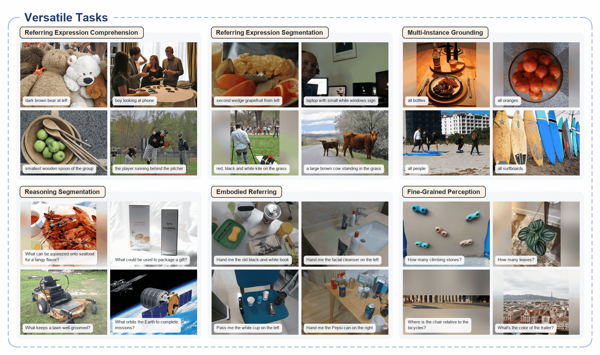

# Xiaomi-Lens-0 模型评测报告

> **版本：2026-11-02** · **当前完成：CV-Bench 静态图片评测（3 组 × 2,638 题）**  
> 本文是 **Xiaomi-Lens-0 的长期实验记录入口**，以后可以按 Benchmark 继续增加新章节。官方模型宣传/论文数据与本地实测数据严格区分。  
> **独立 Markdown：** 文内图片、代码、报告和数据链接全部使用完整 HTTPS 地址；引用的现有仓库文件固定在已核对的提交 3f4618e6b0f7，无需依赖本文件所在目录。

## 1. 模型简介与官方资料

**Xiaomi-Lens-0** 是一个以 Qwen3.5-4B 为基座、面向细粒度视觉感知与像素级 Grounding 的 4B 级多模态模型。它在通用图文回答基础上增加轻量 Mask Decoder，可结合文本推理输出目标区域的 **BBox / 像素级 Mask**；适合指代表达理解、分割、多目标定位和细粒度视觉推理等任务。

| 项目 | 资料 |
|---|---|
| Hugging Face | [SeerRay-Lab/Xiaomi-Lens-0](https://huggingface.co/SeerRay-Lab/Xiaomi-Lens-0) |
| 官方源码 | [SeerRay-Lab/Xiaomi-Lens-0](https://github.com/SeerRay-Lab/Xiaomi-Lens-0) |
| 论文 | [Xiaomi-Lens-0 Technical Report（arXiv:2610.23279）](https://arxiv.org/abs/2610.23279) |
| 项目主页 / 展示 | [Xiaomi-Lens-0 Project Page](https://seerray-lab.github.io/Xiaomi-Lens-0/) |
| 官方演示视频 | [约 98 秒概览视频](https://seerray-lab.github.io/Xiaomi-Lens-0/#video) · [MP4](https://raw.githubusercontent.com/chuiziTom/VLM-test/3f4618e6b0f7a849df21d160519a3a0cde6b8ecf/models/Xiaomi-Lens-0/docs/assets/video/xiaomi_lens_0_overview.mp4) |
| 官方单图部署脚本 | [infer.py](https://github.com/chuiziTom/VLM-test/blob/3f4618e6b0f7a849df21d160519a3a0cde6b8ecf/models/Xiaomi-Lens-0/infer.py) |



**官方评测（非本地复测）：** 官方论文报告了 RefCOCO / RefCOCO+ / RefCOCOg 指代表达理解、指代表达分割、多实例 Grounding、Reasoning Segmentation、Embodied Referring 和细粒度感知等任务；例如在 RefCOCO 系列八个数据划分的指代表达理解指标上，官方报告相对 Qwen3.5-4B 基座平均提升 **5.6 个百分点**。这些结果不能直接与下面 CV-Bench 分数对比。

## 2. 本地部署环境

| 项目 | 实验配置 |
|---|---|
| 系统 | Ubuntu 24.04.5 LTS / Linux 7.0.0-38-generic |
| GPU | NVIDIA RTX PRO 6000 Blackwell Workstation Edition（96 GB 级；PyTorch 可见约 94.96 GiB） |
| NVIDIA 驱动 / CUDA | 580.178.04 / PyTorch CUDA Runtime 12.8 |
| Python / PyTorch | 3.11.18 / 2.10.0+cu128 |
| Micromamba 环境 | `xiaomi-lens` |
| Transformers / Attention | 5.4.0 / `flash_attention_2` |
| 推理精度 / Batch | BF16 / 1 |
| 模型权重 | Hugging Face `SeerRay-Lab/Xiaomi-Lens-0` 的本地缓存快照 `68f57cdd…` |

**部署方式：** 基于官方模型源码的 `XiaomiLensQwen3_5ForConditionalGeneration` 和 `AutoProcessor`，通过 `from_pretrained` 加载权重。官方 [单图推理脚本](https://github.com/chuiziTom/VLM-test/blob/3f4618e6b0f7a849df21d160519a3a0cde6b8ecf/models/Xiaomi-Lens-0/infer.py) 可处理图文指令并输出 BBox / Mask；本项目 CV-Bench 评测只读取**文本选项答案**，不调用分割评价。

本地相关入口：[模型适配器](https://github.com/chuiziTom/VLM-test/blob/3f4618e6b0f7a849df21d160519a3a0cde6b8ecf/evaluation/xiaomi_lens/xiaomi_lens_adapter.py) · [历史 Off/On 评测](https://github.com/chuiziTom/VLM-test/blob/3f4618e6b0f7a849df21d160519a3a0cde6b8ecf/evaluation/xiaomi_lens/run_evaluation.py) · [Direct Answer 评测](https://github.com/chuiziTom/VLM-test/blob/3f4618e6b0f7a849df21d160519a3a0cde6b8ecf/evaluation/direct_answer/run_xiaomi_direct_answer.py) · [环境与依赖说明](https://github.com/chuiziTom/VLM-test/blob/3f4618e6b0f7a849df21d160519a3a0cde6b8ecf/models/Xiaomi-Lens-0/ENV_SETUP.md)。

## 3. 已完成任务：CV-Bench 单张图片

**数据集：** [CV-Bench（Hugging Face）](https://huggingface.co/datasets/nyu-visionx/CV-Bench)，出自 [Cambrian-1（arXiv:2406.16860）](https://arxiv.org/abs/2406.16860)。

只使用 `test_2d.parquet`、`test_3d.parquet`，共 **2,638 条**人工检查的图像选择题。两类数据包含四个任务：

| 类别 | 子任务 | 来源 | 数量 |
|---|---|---|---:|
| 2D | Count（物体计数） | ADE20K + COCO | 788 |
| 2D | Relation（二维空间关系） | ADE20K + COCO | 650 |
| 3D | Depth（物体深度顺序） | Omni3D | 600 |
| 3D | Distance（相对物体距离） | Omni3D | 600 |
| | **总计** | **2D 1,438 / 3D 1,200** | **2,638** |


比如 Count 问“图中有几张桌子”，Depth 问“哪个物体离相机更近”。图片中的红、蓝、绿框用于标识目标，并不是模型生成的分割结果。**未测试连续帧 / 视频；也未执行 Xiaomi 官方的全部分割类 Benchmark。**

### 3.1 测试流程和计分口径

```text
图片 + CV-Bench 问题/选项
  → Xiaomi Processor / Chat Template
  → enable_thinking 开关 → 贪心生成
  → 仅解析最终答案 FINAL_ANSWER: (X)
  → 对照标准选项（Invalid / 截断按错题处理）
  → 汇总 2D、3D、Count、Relation、Depth、Distance 和性能指标
```

| 本地协议 | Thinking | max_new_tokens | 输出约束 |
|---|---|---:|---|
| Legacy（长回答） | Off | 8192 | 最终包含独立答案行 `FINAL_ANSWER: (X)` |
| Legacy（长回答） | On | 8192 | `<think>…</think>` 之后只解析最终答案行 |
| Direct Answer v1 | Off | 64 | **只输出** `FINAL_ANSWER: (X)`，不得附带解释 |

使用 `enable_thinking=False/True` 控制显式 Thinking；三组均为 BF16、`do_sample=False`、Batch=1。同一题的原始选项顺序不变。**8192 / 64 是生成上限，不是每题固定生成长度。**

CV-Bench 官方加权分（并非全题简单平均）：

```text
Acc_2D = (Acc_ADE20K + Acc_COCO) / 2
Acc_3D = Acc_Omni3D
CV-Bench = (Acc_2D + Acc_3D) / 2
```

## 4. 本地实测结果

### 4.1 准确率（全量 2,638 题）

| 指标 | Legacy Off / 8192 | Legacy On / 8192 | Direct Off / 64 |
|---|---:|---:|---:|
| **官方 CV-Bench 总分** | **87.76%** | 87.29% | 87.04% |
| 全样本普通 Accuracy | 87.76%（2315/2638） | 87.23%（2301/2638） | 86.92%（2293/2638） |
| 官方 2D | 83.44% | 83.41% | 82.17% |
| 3D（Omni3D） | 92.08% | 91.17% | 91.92% |
| Count | **74.49%** | 73.86% | 72.46% |
| Relation | 95.85% | **96.15%** | 95.23% |
| Depth | 94.83% | 94.17% | **96.17%** |
| Distance | **89.33%** | 88.17% | 87.67% |

按数据来源：

| 来源 | Legacy Off | Legacy On | Direct Off |
|---|---:|---:|---:|
| ADE20K（633） | 77.57% | 78.99% | 77.25% |
| COCO（805） | 89.32% | 87.83% | 87.08% |
| Omni3D（1200） | 92.08% | 91.17% | 91.92% |

### 4.2 推理速度、资源与输出稳定性

| 指标 | Legacy Off / 8192 | Legacy On / 8192 | Direct Off / 64 |
|---|---:|---:|---:|
| **平均端到端 / 题** | 4.98 s | 19.58 s | **0.299 s** |
| P95 端到端 / 题 | 12.42 s | 65.45 s | **0.404 s** |
| 平均生成 Token | 137.24 | 417.44 | **8.00** |
| 其中平均 Thinking Token | 0 | 302.26 | 0 |
| 生成 Tokens/s（含 Prefill） | 27.80 | 21.39 | 29.45 |
| PyTorch 全局峰值 allocated | 9.36 GiB | 9.36 GiB | 9.36 GiB |
| 无效回答数 | 9（0.34%） | 26（0.99%） | **0** |
| 截断数 | 7 | 11 | **0** |

> **注意：** 截断可能同时计入无效回答，不能把两列相加。端到端耗时不包含模型的单次加载。实验期间 GPU 与其他任务共享，以上绝对时延仅代表当次环境。

### 4.3 结果解读

1. **Thinking On 未带来总体收益。** 与同 Prompt 的 Legacy Off 相比，开启 Thinking 后官方分下降 **0.48 pp**，平均端到端耗时约增加到 **3.93 倍**，而 Relation 子任务略有提升。
2. **Direct Answer 极大减少输出成本。** 平均从 137.24 Token 缩短到 **8 Token**，耗时从 4.98 秒缩短到 0.299 秒（约 **94%**），但总分相比 Legacy Off 下降 **0.72 pp**。
3. **分任务方向并不相同。** Direct Answer 的 Depth 达到 **96.17%**，高于两组 Legacy；Count 和 Distance 则略降。说明应分任务观察，而不能只看总分。
4. **不作错误归因。** Legacy Off 与 Direct Answer 同样关闭了显式 Thinking，但 Prompt、最大 Token 上限与答案解析规则不同；因此不能把两组差异解释成单独的 Thinking 效果。

### 4.4 实测案例与截图补充位置

当前汇总的是已有的机器可读统计；模型逐题原始回答保存在下方链接中的 `predictions.jsonl`。以后可追加“图片—问题—真实答案—三个协议输出—错误分析”的案例表及截图；**不使用推测内容冒充实际模型输出**。

## 5. 原始记录、复核与后续扩展

| 资料 | 固定 HTTPS 链接 |
|---|---|
| Legacy Off 实验（含 metrics / predictions） | [Xiaomi Thinking Off](https://github.com/chuiziTom/VLM-test/tree/3f4618e6b0f7a849df21d160519a3a0cde6b8ecf/experiments/cv_bench/legacy_8192/xiaomi_lens/thinking_off) |
| Legacy On 实验（含 metrics / predictions） | [Xiaomi Thinking On](https://github.com/chuiziTom/VLM-test/tree/3f4618e6b0f7a849df21d160519a3a0cde6b8ecf/experiments/cv_bench/legacy_8192/xiaomi_lens/thinking_on) |
| Direct Off 实验（含 metrics / predictions） | [Xiaomi Direct Answer](https://github.com/chuiziTom/VLM-test/tree/3f4618e6b0f7a849df21d160519a3a0cde6b8ecf/experiments/cv_bench/direct_answer_64_v1/xiaomi_lens) |
| Legacy 双模型详细分析 | [Thinking On/Off 综合核验报告](https://github.com/chuiziTom/VLM-test/blob/3f4618e6b0f7a849df21d160519a3a0cde6b8ecf/reports/legacy_8192/cvbench_qwen35_xiaomi_comparison.md) |
| Direct Answer 单模型详细报告 | [Xiaomi Direct Answer 详细报告](https://github.com/chuiziTom/VLM-test/blob/3f4618e6b0f7a849df21d160519a3a0cde6b8ecf/reports/direct_answer_64_v1/xiaomi_lens_direct_answer_report.md) |
| 独立核验脚本 | [Legacy 复核](https://github.com/chuiziTom/VLM-test/blob/3f4618e6b0f7a849df21d160519a3a0cde6b8ecf/analysis/legacy_8192/verify_results.py) · [Direct 复核](https://github.com/chuiziTom/VLM-test/blob/3f4618e6b0f7a849df21d160519a3a0cde6b8ecf/analysis/direct_answer_64_v1/verify_and_compare.py) |
| 总报告与另一模型 | [CV-Bench 总报告](https://github.com/chuiziTom/VLM-test/blob/main/reports/cv_bench_overall_report.md) · [Qwen3.5-4B 报告](https://github.com/chuiziTom/VLM-test/blob/main/reports/qwen3_5_4b_evaluation.md) |

**复核命令（读取原始实验结果，不重新执行 2,638 题）：**

```bash
cd /home/20261024_1/Workspace/qyh/VLM-test
micromamba run -n vlm-test python -B analysis/legacy_8192/verify_results.py
micromamba run -n vlm-test python -B analysis/direct_answer_64_v1/verify_and_compare.py
```

**未来追加实验的统一写法：** 在本报告后新增一个 `## 6. <Benchmark / 协议名称>（日期）` 章节，固定记录：数据集与任务、模型版本/环境、输入和 Prompt、生成参数、评价指标、准确率/速度/Token/显存、原始结果 HTTPS 链接、局限。**CV-Bench 旧成绩保持不变**，不同 Prompt 或评测口径单独命名，不覆盖原始记录。

---

*本文仅整理已有本地评测记录，不代表发布方复现了本实验；未重新运行模型。*
